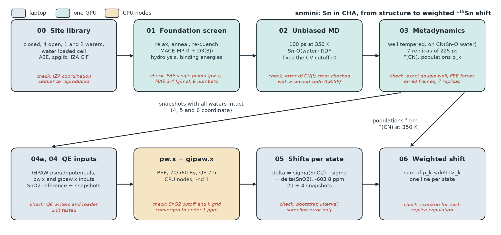
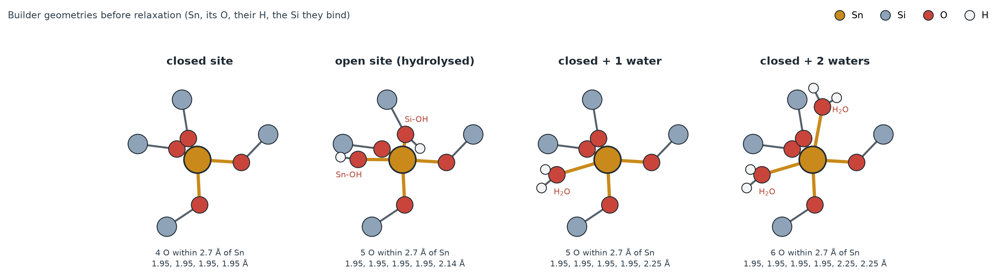
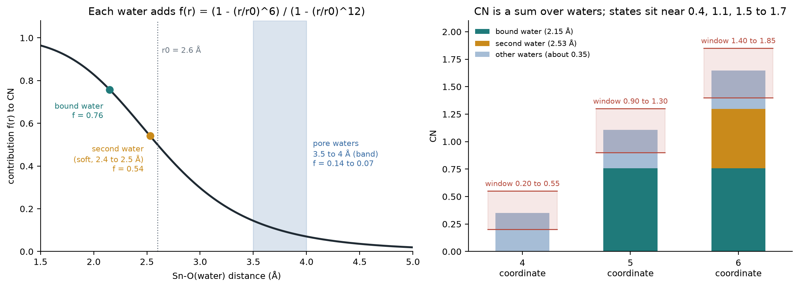
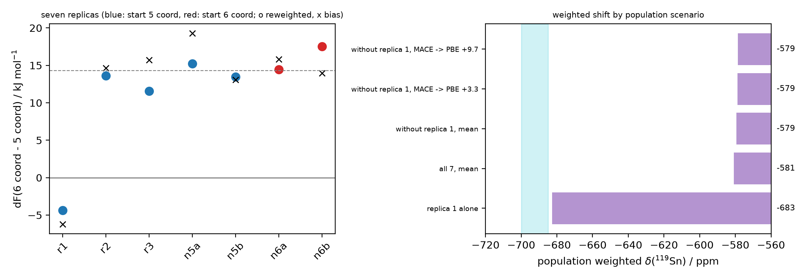
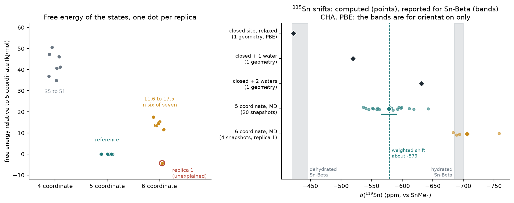

# snmini: Sn sites in a zeolite, in miniature

A small, complete workflow for one question: **when water binds to a framework
Sn site at finite temperature, how many water molecules sit on Sn, and what does
that do to the ¹¹⁹Sn NMR shift?**

It runs on Sn substituted chabazite (one T site, a 36 atom cell, 54 atoms with
six waters), so every step fits on one GPU and a few CPU nodes. It is a model of
the workflow, not of Sn-Beta; see "What this does not show". Results, limits and
takeaways are below, and `structures/` holds the systems as CIF files.



*Figure 1. The pipeline from site library to weighted shift. Colour shows where a
step runs; the red line in each box is the check made against a known answer or a
second method.*

## Motivation

Sn-containing zeolites such as Sn-Beta turn glucose into fructose in water [11].
The active Sn atom sits in the framework, and its surroundings depend on water.
Three kinds of site are discussed: a closed site, Sn bound to four framework
oxygens; an open site, where one Sn–O–Si bond is hydrolysed to Sn–OH next to a
silanol; and a site with one or two water molecules bound, five or six coordinate
Sn (Figure 2). ¹¹⁹Sn NMR sees the difference: hydrated Sn-Beta resonates near
−685 to −700 ppm, dehydrated Sn-Beta at about −420 to −446 ppm, and the assignment of
the dehydrated lines to open and closed sites is itself debated [1, 12, 2].

At reaction conditions a site is not one structure. It exchanges water, so the
NMR spectrum is an average over states, and an average needs two things: how
often each state occurs, a free energy question, and what shift each state gives,
a quantum chemistry question. This repository answers both on one small system
and joins them. The aim was to build the whole chain with free software, check
each step against a known answer, and find where it breaks.



*Figure 2. The four starting structures of the site library, as built, before
relaxation. Orange bonds are Sn–O within 2.7 Å; the numbers are the Sn–O
distances of the builder. In MACE + D3 the four open variants did not open
(section "Results").*

## Design

| choice | why | how it was checked |
|---|---|---|
| Sn in chabazite, one T site, 36 atoms | the site space (closed, four open, hydrated) is complete in a few atoms; glucose does not pass the 8 ring windows, so no sugar | IZA coordination sequence reproduced; open sites add exactly one H₂O |
| MACE-MP-0 foundation model with D3(BJ) [13] for relaxation and dynamics | 42 to 55 ms per step on one GPU makes 225 ps replicas affordable [7] | PBE single points and PBE forces |
| one collective variable: CN of Sn by six water oxygens | one bound water against none is the slow event in the MD (no exchange in 100 ps); r0 = 2.6 Å, in the same empty gap as the first RDF minimum (2.51 Å) | finite differences of CN and bias forces; the CV is an assumption, tested only through the replicas |
| well tempered metadynamics, bias factor γ = 10, 350 K, seven replicas of 225 ps [5] | free energy F(CN) and state populations from window integrals; replicas give a spread | exact double well; stored bias rebuilt from HILLS; second estimator (reweighting [10]) |
| states defined by CN windows, GIPAW on snapshots with all waters intact | GIPAW is too costly to run along a trajectory; the CN windows were checked on the stored structures | water integrity check; 4 and 20 snapshots, bootstrap interval |
| Quantum ESPRESSO 7.5 with QE-GIPAW, PBE, shifts referenced to SnO₂ at −603.8 ppm [4, 6] | free software; one reference compound for every state | SnO₂ cutoff and k grid converged to under 1 ppm |
| weighted shift Σ p_k ⟨δ⟩_k | populations from step 03, state shifts from step 05 | scenario for each replica population |
| single cell scripts, a `CONFIG` block, 34 tests | readable and rerunnable in Jupyter or a terminal | tests on cluster and in a clean Python 3.10 environment |

CN is the coordination number of Sn by water oxygen, with the switching function
PLUMED uses for `COORDINATION`, so the same variable can be cross checked in
PLUMED (`plumed/`). With r0 = 2.6 Å, n = 6, m = 12 a water at 2.15 to 2.4 Å
counts 0.76 to 0.62, and each of the other waters at 3.5 to 4 Å counts 0.14 to
0.07 (together about 0.3 to 0.4 here, depending on how many waters are left). In
the water loaded cell the states therefore sit
near CN 0.4 (no bound water, 4 coordinate Sn), 1.1 (one bound water) and 1.5 to
1.7 (two bound waters), not at 0, 1 and 2. The stored structures confirm this: at
CN 0.2 to 0.55 99 percent of the frames have no water oxygen within 2.8 Å of Sn,
at CN 0.9 to 1.3 exactly one (99.8 percent), at CN 1.4 to 1.85 two in 88 percent.



*Figure 3. Left: contribution of one water to CN. Right: the CN of each state as
a sum over waters, against the CN windows from which snapshots were taken.*

The weighted shift is the first moment of the spectrum: the position of one line
if exchange between the states is fast on the NMR time scale, the centre of two
lines weighted by the populations if it is slow. For the 128 ppm between the 5
and 6 coordinate states below, about 19 kHz at 9.4 T, the exchange rate was not
computed.

## Pipeline

| step | script | what it does | where it runs |
|---|---|---|---|
| 00 | `00_build_structures.py` | closed site, every symmetry distinct open site, 1 and 2 bound waters, a water loaded cell | laptop, seconds |
| 01 | `01_screen_foundation.py` | MACE foundation model relaxations with anneal and re-quench; hydrolysis and water binding energies | GPU, 81 min |
| 01b | `analysis/dft_check.py` | PBE single points (pw.x) at the step 01 geometries against MACE | CPU nodes |
| 02 | `02_md_rdf.py` | unbiased MD; Sn–O(water) RDF; picks the CV cutoff r0 at the first minimum | GPU, 100 ps in 2.4 h |
| 03 | `03_metad.py` | well tempered metadynamics on CN; stores every frame, checkpoint and restart | GPU, 225 ps in about 7.5 h (55 ms per step, 54 atoms) |
| 03b, 03c | `03b_umbrella.py`, `03c_umbrella_mbar.py` | umbrella sampling windows and MBAR [9], an independent free energy estimate (code and tests only, no production run) | GPU |
| 04a | `04a_gipaw_pseudos.py` | checks the pseudopotentials for GIPAW data; regenerates pslibrary PAW files with `ld1.x` where needed | cluster, minutes |
| 04 | `04_gipaw_inputs.py` | Quantum ESPRESSO inputs (pw.x, then gipaw.x) for SnO2 and snapshots of each state; CASTEP or VASP as options | cluster, seconds |
| 05 | `05_gipaw_analysis.py` | reads gipaw.x output, references to SnO2, averages per state with error bars | laptop |
| 06 | `06_weighted_spectrum.py` | population weighted ¹¹⁹Sn spectrum | laptop |

`analysis/` holds the checks used on the runs: water integrity, PBE force check,
frame selection, estimator and state definition checks, a check of the stored
bias and of equal weights in a CN window, replica summaries.
`analysis/make_overview_figures.py` redraws the four figures of this page.
`analysis/crisp/` uses modules of CRISP (github.com/Indranil17/CRISP), which are
not bundled.

Every script runs as one Jupyter cell or from a terminal; all settings sit in a
`CONFIG` block at the top. With `CALC = "toy"` the dynamics scripts run end to end
on a zero calculator, which tests the plumbing without a GPU; its numbers mean
nothing by design.

## Validated before use

* **Metadynamics engine.** On a tilted double well with a known free energy, it
  recovers F(x) to 0.09 to 0.22 kT (RMSE) and the free energy difference between
  the two wells to within 0.3 kT, about 1 kJ/mol at 350 K, in 15 repeats of 1.6
  million steps. The population of the right well has a seed to seed scatter of
  0.02 (largest error 0.04), so it is not quoted more tightly
  (`scripts/validate_metad_doublewell.py` for three seeds, reference output in
  `docs/validation_doublewell.png`; `analysis/double_well_repeats.py` for the 15
  repeats, reference output in `docs/validation_doublewell_repeats.json`).
* **Umbrella sampling and MBAR [9].** Reproduce the exact free energy difference of
  two Gaussians to 0.03 kT and an exact double well PMF within 0.25 kT.
* **Collective variable.** CN and its gradient match finite differences to
  1e-7; bias forces equal minus the gradient of the bias energy.
* **Structures.** The builder reproduces the IZA coordination sequence of CHA
  (4, 9, 17, 29, 45, 64); open sites add exactly one H2O; no atom clashes.
* **NMR bookkeeping.** Shielding to shift conversion, Herzfeld–Berger tensor
  parameters, the gipaw.x, `.magres` and `OUTCAR` readers, the Quantum ESPRESSO
  input writers and the pseudopotential checks are unit tested.
* **Error bars.** On a correlated AR(1) series the integrated autocorrelation
  time is within 10 percent of the exact value, the autocorrelation and block
  averaging errors agree to within a factor of 1.6, and the Flyvbjerg–Petersen
  blocking curve [8] rises to more than twice the naive error.
* **Run files.** The bias stored along a run equals the bias rebuilt from the
  hills to 2e-4 kJ/mol on the engine's grid (up to 8e-3 kJ/mol against analytic
  Gaussians, the grid interpolation). The free energy from the bias agrees with a
  second estimator, a reweighted histogram of the same frames (Tiwary and
  Parrinello [10]), within 4.1 kJ/mol at the end of the runs. Both use the same CV and
  the same potential, so this checks the algebra, not the choice of CV.

34 tests, about 25 seconds (all pass on the cluster the runs were made on, and on
a second machine, Windows 11 with Python 3.12). A CI workflow that runs them on
every push is included.

## Quick start

```bash
conda env create -f environment.yml
conda activate snmini
pytest -q
python scripts/validate_metad_doublewell.py
python scripts/00_build_structures.py
```

Then run 01 to 03 on a GPU node (`hpc/gpu_dynamics.pbs`), prepare the
pseudopotentials with 04a, run the GIPAW folders from 04 on CPU nodes
(`hpc/cpu_gipaw.pbs`; Quantum ESPRESSO with QE-GIPAW), and 05 and 06 anywhere.
`docs/runbook.md` lists the checks to make between steps. With Quantum ESPRESSO
7.5 `gipaw.x` stopped on the 36 to 54 atom cells unless run with `-nd 1` (serial
dense linear algebra); the written `job.sh` files do this.

## Results

Made with MACE-MP-0 (medium) plus D3(BJ) at 350 K on one water loading (six
waters in a 12 T site cell), Quantum ESPRESSO 7.5 with PBE for DFT and GIPAW,
shifts referenced to SnO2. Figures and data are in `docs/results/`; the run diary
is `docs/run_log.md`.

| quantity | value | condition |
|---|---|---|
| hydrolysis energy of the four open variants | +8.5, −7.5, −30.6, −14.8 kJ/mol (MACE + D3); PBE single points differ by 0.5 to 7.0 kJ/mol (mean 3.4) | one geometry each; none of the four opens: the bridging O stays protonated 2.1 to 2.4 A from Sn; no PBE relaxation |
| binding energy per water, 1 and 2 waters | −49.4 and −44.6 kJ/mol | MACE + D3, relaxed geometries |
| r0 from the Sn–O(water) RDF | first peak 2.14 A, first minimum 2.51 A | 100 ps, one water bound the whole time; the runs use 2.6 A, in the same empty gap |
| MACE against PBE on 60 metadynamics frames | force RMSE 80 meV/A (H 70, O 64, Si 105, Sn 201); energy spread 1.6 meV/atom; MACE stabilises the two water state by 9.7 ± 1.8 kJ/mol relative to PBE | PBE without D3, 30 frames per state, two water frames from one run |
| free energy of the 6 coordinate state against the 5 coordinate one | about +12 to +18 kJ/mol in six of seven replicas (reweighted estimate; 13 to 19 from the bias; +16 to +17 with states defined by 1 or 2 water oxygens within 2.8 A); one replica gives −4 and is unexplained | 7 replicas of 225 ps; the value depends on where the CN windows are cut |
| cost of losing the bound water (4 coordinate) | 35 to 51 kJ/mol | window integrated, no minimum there |
| ⟨δ(¹¹⁹Sn)⟩, closed relaxed site | −422.5 ppm; one water −519.8; two waters −631.4 | one relaxed geometry each, PBE |
| ⟨δ(¹¹⁹Sn)⟩, 5 coordinate state | −578.5 ppm, 95 percent interval −591 to −567 | 20 snapshots, sampling error only, frames with intact water |
| ⟨δ(¹¹⁹Sn)⟩, 6 coordinate state | about −706 ppm | preliminary: 4 snapshots from one replica, range −683 to −758 |
| population weighted ⟨δ(¹¹⁹Sn)⟩ | about −579 ppm | the 6 coordinate state carries under 2 percent, so a 50 ppm error in its shift moves this by 0.4 to 0.9 ppm; replica 1 alone would give −683 |



## What this does not show

* **CHA, not Beta.** One T site keeps the site space complete and cheap. Beta has
  nine T sites and is where the chemistry of interest happens. The closed site
  (−422.5 ppm) falls within the range of dehydrated Sn-Beta resonances
  (about −420 to −446 ppm [1, 12, 2]), near its downfield edge; that is not a
  validation of the method.
* **One water loading, one collective variable, 225 ps.** One of seven replicas
  disagrees on the free energy of the second water and the cause is not known.
  A variable that the CN does not describe may be missing.
* **Foundation model.** MACE-MP-0 is used as a screening model. Its Sn forces
  differ from PBE by 19 percent and it favours the second water by about
  10 kJ/mol; production work needs fine tuning.
* **¹¹⁹Sn from periodic GIPAW is not absolute.** Even the best molecular
  protocols reach mean absolute deviations below 100 ppm over a range of about
  4650 ppm [3]. Shifts here are referenced to SnO2, whose measured shift is
  −603.8 ppm against SnMe4 [4], with scalar relativistic pseudopotentials and
  PBE, and should be read as differences between states. Differences remove a constant offset only; an error that
  scales with the shift stays, and this study did not test it. The intervals above
  are sampling errors only.
* **Snapshots with a transient proton transfer** (about 14 percent of the
  5 coordinate frames) are left out of the shift averages.
* **No sugars.** Glucose does not pass the 8 ring windows of CHA; sugar
  adsorption needs a large pore framework.
* **Snapshots and weights.** NMR snapshots come from the biased run, selected in
  a narrow CN window around each state, with equal weights. At fixed CN the
  frames are Boltzmann distributed, because the bias depends on CN only. Across
  the window the CN distribution is the tempered one, proportional to
  exp(−F/(γ kT)), not exp(−F/kT). On the measured F(CN) this moves the mean CN by
  −0.008 (5 coordinate window, F rises 3.6 kT) and +0.067 (6 coordinate window,
  4.9 kT), which changes the 5 coordinate shift by 0.2 ppm for a correlation of
  0.08 between shift and CN (the correlation measured with all 20 snapshots is
  0.03, so the effect is smaller), and by 1 ppm at most for a correlation of 0.5.
  For the 6 coordinate shift the same arithmetic gives 1 ppm (correlation 0.08)
  to 7 ppm (0.5), against a spread of 35 ppm over four snapshots
  (`analysis/check_bias_and_window_weights.py`).
* **Free software throughout.** ASE [16], MACE (the MACE-MP-0 models are MIT
  licensed) [7], PLUMED [15], Quantum ESPRESSO [14] and QE-GIPAW [6].

## Takeaways



*Figure 4. Left: free energy of the three states relative to the 5 coordinate
state, one dot per replica (reweighted estimate, second half of each run). Right:
computed ¹¹⁹Sn shifts. Bands are the ranges reported for Sn-Beta, shown for
orientation only: the model is CHA and the shifts are PBE.*

1. **The chain works end to end on free software.** From an IZA CIF to a
   population weighted ¹¹⁹Sn shift, with 34 tests, and each step checked against a
   known answer or a second method (Figure 1).
2. **In this model Sn carries one bound water at 350 K.** The 5 coordinate state
   is the lowest in six of seven replicas. The 6 coordinate state lies 11.6 to
   17.5 kJ/mol above it (reweighted) and the 4 coordinate state 35 to 51 kJ/mol,
   so the 6 coordinate state carries under 2 percent. Replica 1 puts the 6
   coordinate state 4.4 kJ/mol lower, and the cause is not known.
3. **The shift follows the coordination.** Closed relaxed site −422.5 ppm, one
   water −519.8, two waters −631.4 (209 ppm); in the dynamics the 5 coordinate
   state is −578.5 ppm (interval −591 to −567, sampling error) and the 6
   coordinate state about −706 ppm (four snapshots, one replica, preliminary).
   The population weighted shift is about −579 ppm. These are PBE shifts of a CHA
   model, to be read as differences; a scaling error is untested.
4. **MACE-MP-0 is a screening tool here.** Relative energies are within 3.4 kJ/mol
   of PBE on six numbers, but the Sn forces are 19 percent off PBE (RMSE 201
   meV/Å) and the second water is too favourable by 9.7 ± 1.8 kJ/mol. The open
   sites stay closed in MACE + D3, which says something about the potential and
   not about Sn-Beta; a PBE relaxation was not done.
5. **Checks found real errors.** A symmetry tolerance that split the one T site of
   CHA into four; a snapshot weighting that used the growing bias; figures that
   hid missing data; a `gipaw.x` crash that only a serial linear algebra setting
   (`-nd 1`) fixed; a CN to coordination mapping that was wrong; and a later
   check showed that equal weights inside a CN window are only approximate
   (`docs/run_log.md`, sections 2, 6, 8 and 10).
6. **What would change the conclusions.** An independent free energy estimate
   (umbrella sampling with MBAR, code written, not run) or a second collective
   variable, to settle replica 1; fine tuning on Sn site reference data; two more
   water loadings; more snapshots, including 6 and 4 coordinate ones from the
   newer replicas; a calibration set of Sn(IV) compounds with measured shifts to
   test the GIPAW scaling; a PBE relaxation of the open sites.

## Structures

`structures/` holds the systems as CIF files, so that you can look at what was
studied and what happened: the built and the relaxed site models, frames of the
unbiased MD and of the metadynamics runs for each coordination state, two
trajectories, and the 28 snapshots behind the ¹¹⁹Sn shifts (`structures/README.md`,
`structures/index.csv`).

## Data

`docs/results/data/` holds the numbers behind the table (`energies.csv`,
`derived.json`, `comparison.json`, `summary.json` of step 02,
`force_check_summary.json`, `energy_offsets.json`, `all_replicas_summary.json`,
`characterise_states.json`, `check_state_definitions.json`,
`relaxed_site_shifts.json`, `snapshot_shifts_4each.json` and
`delta_119Sn_5c_20_snapshots.csv`). Trajectories, HILLS files and pw.x or gipaw.x
outputs are not in the repository.

## References

1. R. Bermejo-Deval et al., *Proc. Natl. Acad. Sci. USA* **109**, 9727 (2012).
2. G. Qi et al., *Commun. Chem.* **1**, 22 (2018).
3. J. B. Stückrath, T. Gasevic, M. Bursch, S. Grimme, *Inorg. Chem.* **61**, 3903 (2022).
4. A. E. Aliev, A. P. Bartók, J. R. Yates, *Solid State Nucl. Magn. Reson.* **89**, 1 (2018).
5. A. Barducci, G. Bussi, M. Parrinello, *Phys. Rev. Lett.* **100**, 020603 (2008).
6. C. J. Pickard, F. Mauri, *Phys. Rev. B* **63**, 245101 (2001).
7. I. Batatia et al., *J. Chem. Phys.* **163**, 184110 (2025).
8. H. Flyvbjerg, H. G. Petersen, *J. Chem. Phys.* **91**, 461 (1989).
9. M. R. Shirts, J. D. Chodera, *J. Chem. Phys.* **129**, 124105 (2008).
10. P. Tiwary, M. Parrinello, *J. Phys. Chem. B* **119**, 736 (2015).
11. M. Moliner, Y. Román-Leshkov, M. E. Davis, *Proc. Natl. Acad. Sci. USA* **107**, 6164 (2010).
12. R. Bermejo-Deval, R. Gounder, M. E. Davis, *ACS Catal.* **2**, 2705 (2012).
13. S. Grimme, S. Ehrlich, L. Goerigk, *J. Comput. Chem.* **32**, 1456 (2011).
14. P. Giannozzi et al., *J. Phys.: Condens. Matter* **21**, 395502 (2009); **29**, 465901 (2017).
15. G. A. Tribello, M. Bonomi, D. Branduardi, C. Camilloni, G. Bussi, *Comput. Phys. Commun.* **185**, 604 (2014).
16. A. H. Larsen et al., *J. Phys.: Condens. Matter* **29**, 273002 (2017).

## Licence and citation

MIT. See `CITATION.cff`. Author: Indranil Saha (ORCID 0009-0005-6111-3599).
